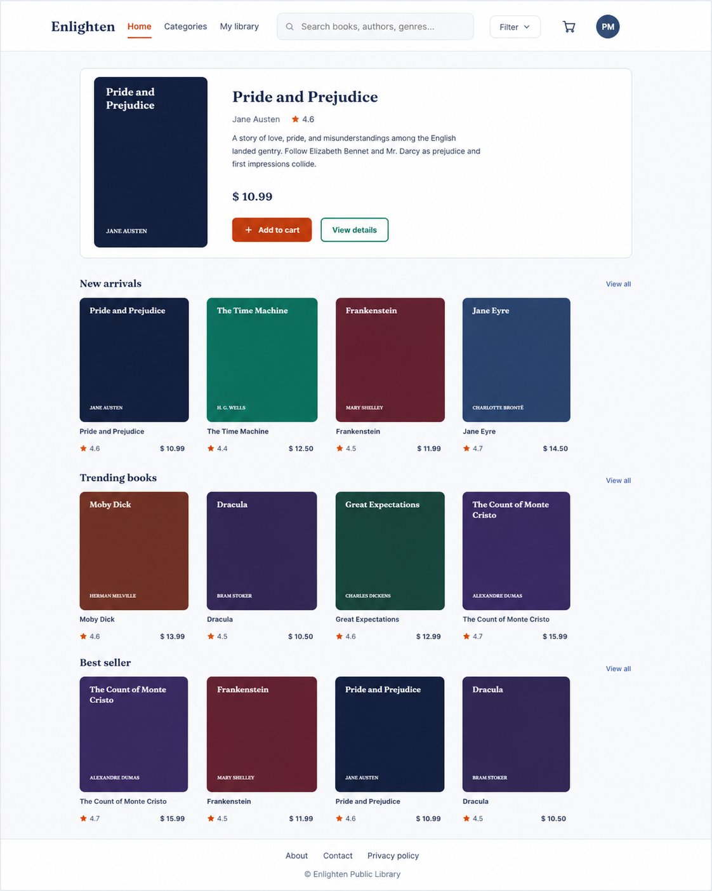
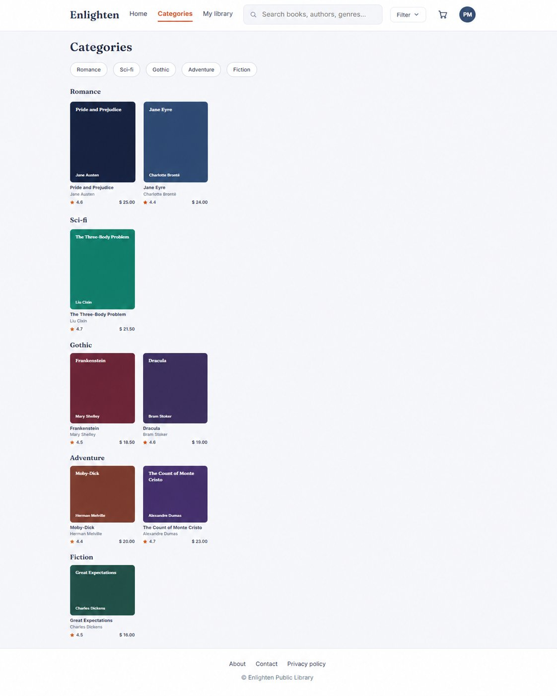
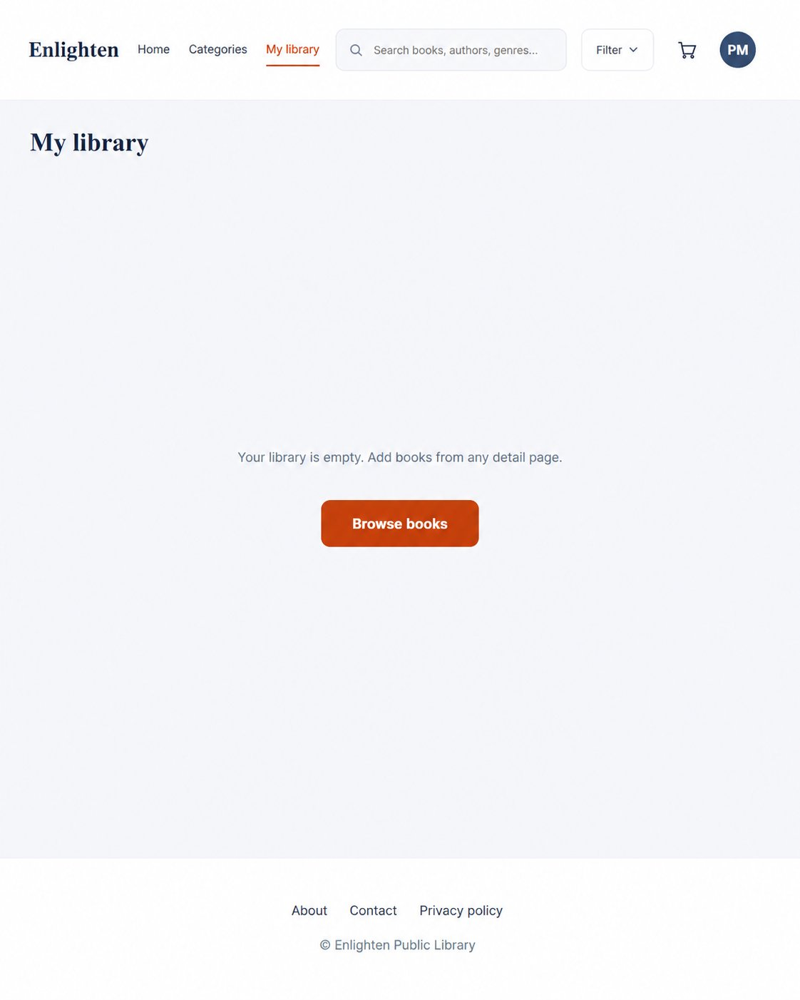
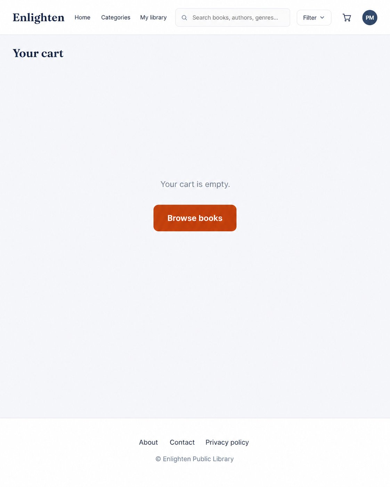
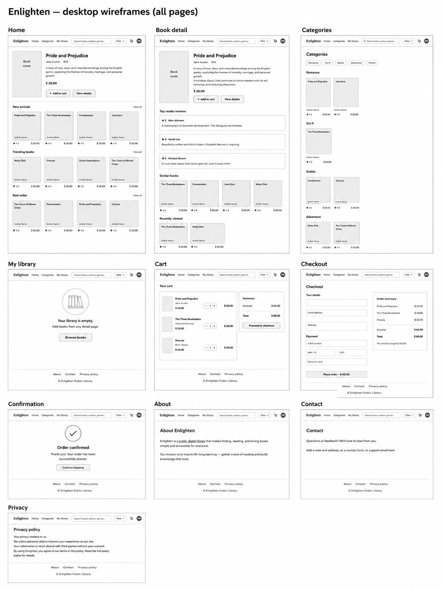

# Enlighten - Public Library

A complete, responsive, multi-page eBook library and store, built **HTML, CSS, and JavaScript**.  Browse
the catalogue,filter and search, open a book, add to a cart, and complete checkout with an order
confirmation. Cart, library, and recently-viewed lists persist across pages.

## Preview

**Home**



**Categories** - books grouped by genre, with filter and search



**My library** and **Cart**




**Wireframes - all pages (desktop)**



## Features

- **Ten pages**, each its own HTML file: Home, Book detail, Categories, My Library,
  Cart, Checkout, Confirmation, About, Contact, Privacy.
- **Browse & discover** - featured hero, New arrivals, Trending, and Best seller rows.
- **Filter & search** - a Genre/Author filter dropdown and a live search that match
  on title, author, and genre.
- **Book cards** with hover lift, shadow, and a quick-add button.
- **Cart & checkout** - add/remove items, running subtotal, a validated checkout form,
  and an order-confirmation page with a reference number.
- **My library** - save titles and find them on a dedicated page.
- **Persistence** - cart, library, and recently-viewed survive page loads via `localStorage`.
- **Responsive** down to mobile with a slide-in navigation drawer.
- **Accessible** - skip link, keyboard focus states, ARIA on interactive regions,
  `aria-live` status messages, and reduced-motion support.
- **Active-page navigation** highlighting in the brand accent colour.

## Pages

| File | Purpose |
|------|---------|
| `index.html` | Home - hero + New arrivals / Trending / Best seller |
| `book.html` | Book detail (`book.html?id=1`) - summary, reviews, similar, recently viewed |
| `categories.html` | Books by genre; also handles `?genre=`, `?author=`, and `?q=` filters |
| `library.html` | My library - saved books |
| `cart.html` | Cart with subtotal |
| `checkout.html` | Checkout form + order summary |
| `confirmation.html` | Order confirmed (`?ref=…`) |
| `about.html` · `contact.html` · `privacy.html` | Footer information pages |

## Project structure

```
enlighten/
├── index.html
├── book.html
├── categories.html
├── library.html
├── cart.html
├── checkout.html
├── confirmation.html
├── about.html
├── contact.html
├── privacy.html
├── styles.css          
├── data.js             
├── app.js              
├── images/             
└── README.md
```


Serving the folder (rather than opening files directly) lets `localStorage` persist the
cart and library across pages.

## How it works

Each HTML file sets `<body data-page="…">`. `app.js` reads that attribute and renders the
matching content into `<main id="main">`, so the header, navigation, and footer stay
identical across every page and real links move between them.

## Customising

- **Re-skin the whole site:** the `:root` design tokens at the top of `styles.css`
  (`--accent`, `--ink`, fonts, radii).
- **Edit the catalogue:** the `BOOKS` array in `data.js`. Add `img:"images/your-cover.jpg"`
  to any book to use a real cover image instead of the typographic one.

## Implementation notes

- The catalogue uses public-domain titles. Ratings and reviews are sample content.
- Checkout is a front-end flow for demonstration — it validates input and confirms an
  order, but does not connect to a real payment gateway.

## Built with

HTML5 · CSS3 · JavaScript (ES5+, no dependencies) · Fraunces + Inter (Google Fonts)
